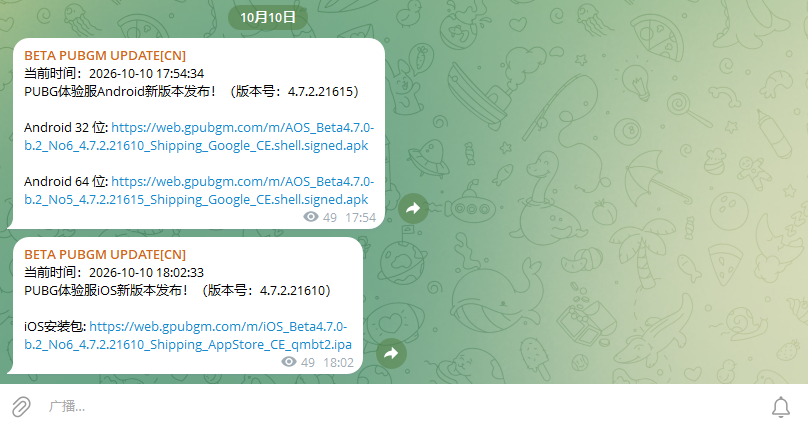

# GAME UPDATE CHECK

**语言 / Language:** **中文** ・ [English](README_EN.md)

---

## 项目简介

这是一个从现有成品中**开源**出来的游戏版本更新检测项目，整套检测逻辑基于 **Cloudflare Worker + JavaScript** 实现，支持检测以下游戏的版本更新：

- 和平精英
- BETA PUBGM
- PUBGM
- BGMI

## 工作原理

- **网页读取**：从网页读取 `.apk` 信息，获取最新版本号
- **本地对比**：本地保存当前版本，与检测到的最新版本进行对比
  - 检测到的版本 **低于** 当前版本 → 不推送
  - 检测到的版本 **高于** 当前版本 → 推送更新

## 技术实现（Cloudflare Worker）

整套逻辑运行在 **Cloudflare Worker** 上，纯 JavaScript 实现，无需自备服务器：

- **运行方式**：Worker 执行 JS，用 `fetch` 抓取 `web.gpubgm.com` 页面，再用正则提取 `.apk` / `.ipa` 下载链接与版本号
- **定时触发**：通过 Cron Triggers 定时自动检测 Android + iOS
- **手动触发**：访问 Worker 的 `/android`、`/ios` 路径即可立即检测一次
- **数据存储**：Cloudflare KV（绑定名 `PUBG_KV`）保存当前版本号与下载链接，实现「本地对比」（键名清单见下方「KV 配置」）
- **消息推送**：检测到新版本后，通过 Telegram Bot `sendMessage` 推送至频道 / 话题
- **源码位置**：[`beta/beta.js`](beta/beta.js)（BETA PUBGM 体验服）、[`hp/hp.js`](hp/hp.js)（和平精英体验服）、[`bgmi/bgmi.js`](bgmi/bgmi.js)（BGMI 印度服）

> 使用前，请把 `beta/beta.js` 顶部的 `TG_BOT_TOKEN`、`TG_CHAT_ID`（频道 / 群组 ID）和 `TG_THREAD_ID`（话题 ID，不使用话题填 `0`）替换成你自己的配置（获取方法见下方「使用教程」）。

## 使用教程（一）：用 @BotFather 创建 Bot，获取 `TG_BOT_TOKEN`

1. 在 Telegram 搜索并打开 **@BotFather**（官方机器人，带蓝勾认证）
2. 发送 `/newbot` 开始创建
3. 按提示输入 **Bot 显示名称**（名字随意取，例如 `Game Update Check`）
4. 再输入 **Bot 用户名**（必须全局唯一、以 `bot` 结尾，例如 `game_update_check_bot`）
5. 创建完成后，BotFather 会发给你一串 **Token**，格式类似：

   ```
   123456789:AAxxxxxxxxxxxxxxxxxxxxxxxxxxxxxxxxx
   ```

   这串就是 `TG_BOT_TOKEN`，**务必保密**；一旦泄露（比如传到了公开仓库），立刻对 BotFather 发送 `/revoke` 重新生成并替换
6. 其他常用命令：`/mybots`（管理 Bot）、`/token`（重新查看 Token）、`/setprivacy`（设置群内隐私模式）

## 使用教程（二）：获取群组 ID 与话题 ID（`TG_CHAT_ID` / `TG_THREAD_ID`）

1. 把刚创建的 Bot **拉进你的群组**，并开启**发送消息权限**（建议直接设为管理员）
2. 在群里发一条测试消息；如果开了话题，就发在**目标话题**里
3. 浏览器打开下面这个地址（把 `<你的TOKEN>` 换成教程（一）里的 Token）：

   ```
   https://api.telegram.org/bot<你的TOKEN>/getUpdates
   ```

   如果列表为空，可以在群里发一条 `/start@你的Bot用户名` 再刷新
4. 在返回的 JSON 里找到：
   - `"chat": { "id": -100xxxxxxxxxx }` → 填入 **`TG_CHAT_ID`**
   - `"message_thread_id": 4` → 填入 **`TG_THREAD_ID`**（话题 ID；没有话题或不需要话题就填 `0`）
5. 查话题 ID 的另一种方法：在目标话题里对任意消息「复制链接」，形如：

   ```
   https://t.me/c/1234567890/4/123
   ```

   中间那段数字（`4`）就是话题 ID

> 推送到「频道」也可以：把 Bot 加为频道管理员，在频道里发一条消息，`getUpdates` 返回的 `channel_post` 里的 `chat.id` 就是 `TG_CHAT_ID`（频道一般没有话题，`TG_THREAD_ID` 填 `0`）。

## KV 配置（Cloudflare KV）

部署前需要先在 Cloudflare 创建一个 **KV 命名空间**，并把它绑定到每个 Worker（**绑定变量名必须是 `PUBG_KV`**，三个脚本都通过 `env.PUBG_KV` 访问）：

1. Cloudflare 控制台 → **Workers 和 Pages → KV** → **创建命名空间**（名字随意，例如 `pubg-kv`）
2. 打开每个 Worker → **设置 → 变量和绑定 → KV 命名空间绑定**：变量名填 `PUBG_KV`，选择刚创建的命名空间
3. 保存并重新部署即可

各脚本读写的 KV 键（Key）如下——**无需手动创建**，脚本检测到更新时会自动写入：

### beta/beta.js（BETA PUBGM 体验服）

| Key | 用途 |
| --- | --- |
| `pubg_exp_current_version` | Android 总版本号（用于对比） |
| `pubg_exp_32_version` / `pubg_exp_32_url` | Android 32位 版本号 / 下载链接 |
| `pubg_exp_64_version` / `pubg_exp_64_url` | Android 64位 版本号 / 下载链接 |
| `pubg_exp_apk_links` | Android 32/64位 链接汇总 |
| `pubg_ios_current_version` | iOS 当前版本号 |
| `pubg_ios_ipa_links` | iOS 安装包链接 |

### hp/hp.js（和平精英体验服）

| Key | 用途 |
| --- | --- |
| `hpios_current_version` | iOS 当前版本号 |
| `hpios_ipa_link` | iOS 安装包链接 |
| `hpandroid_current_version` | Android 当前版本号 |
| `hpandroid_apk_link` | Android 安装包链接 |

### bgmi/bgmi.js（BGMI 印度服）

| Key | 用途 |
| --- | --- |
| `bgmi_current_version` | 当前版本号 |
| `bgmi_apk_link` | APK 下载链接 |

> 三个脚本共用同一个绑定名 `PUBG_KV`：可以共用一个命名空间（Key 互不冲突），也可以各建一个命名空间分别绑定，效果一致。

## 说明

本项目采用的是「从网页读取 `.apk`」的方案，而不是另一种方案——**另一种方案我们无法开源**。

## 运行截图


